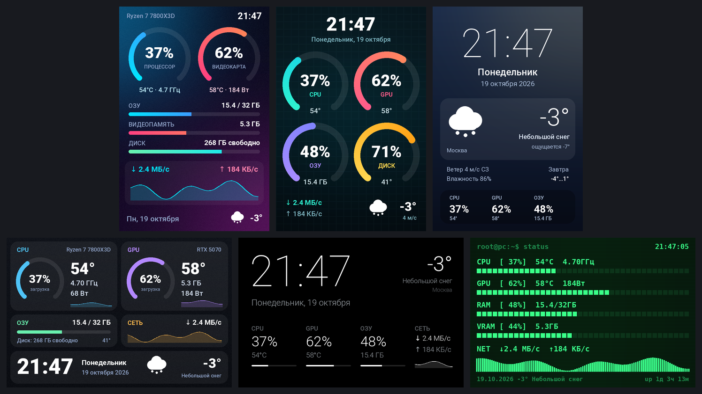
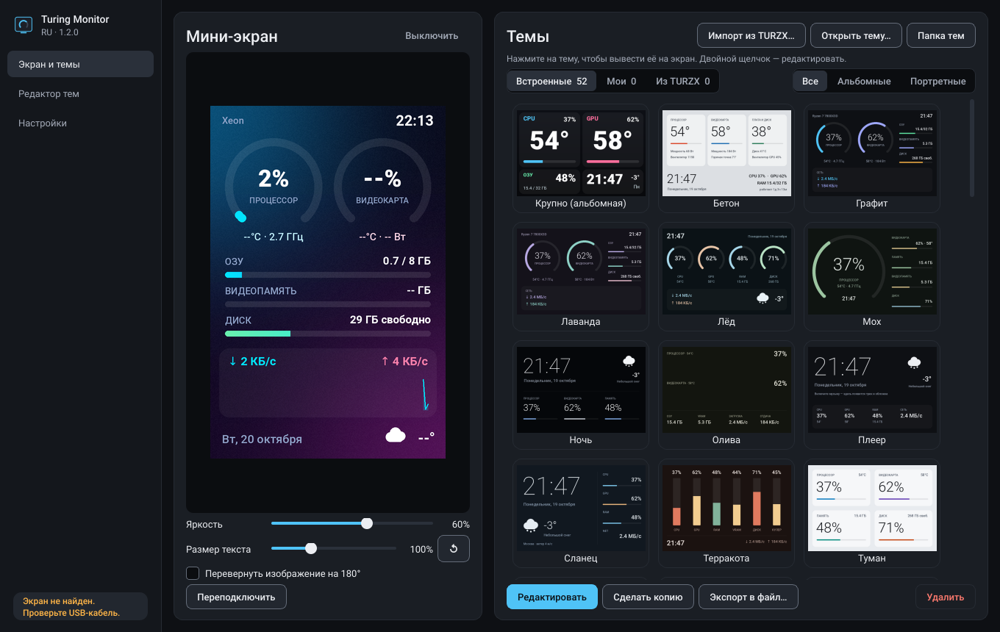
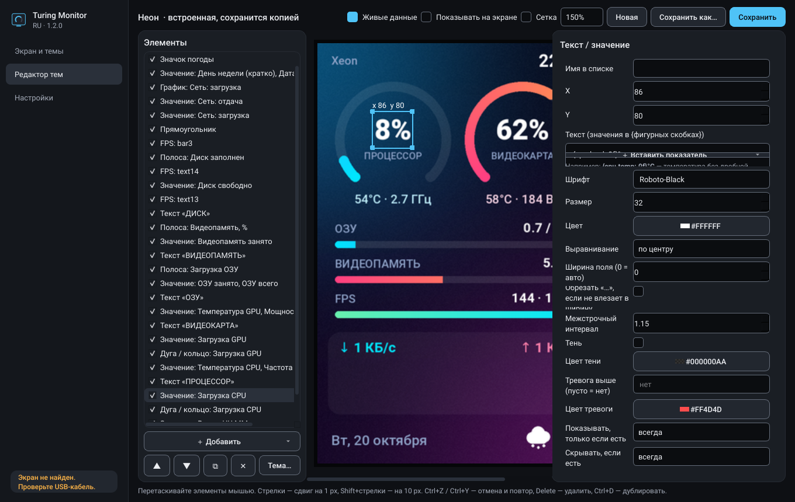

# Turing Monitor RU

Свободная замена программе **TURZX / UsbMonitor** для USB-мини-экрана **Turing Smart Screen 3.5"**.
Полностью на русском, с нормальным редактором тем, работой из трея и импортом старых тем.



## Возможности

- **52 готовые темы** в стиле «Графит»: сдержанные (Графит, Туман, Сланец, Лёд, Мох, Бетон, Ночь, Лаванда…),
  игровые (Киберпанк, Плазма, Лава, Океан, Токио, Матрица, Ретровейв…) и приборы (Осциллограф, Янтарь, Бумага,
  Радар, ЖК-дисплей, Сепия, Вакуумный индикатор…), а также темы-плееры с обложкой.
- **Разделы тем**: «Встроенные», «Мои» и «Из TURZX», фильтр по ориентации.
- **Обмен темами одним файлом** `.tmtheme` (тема вместе с картинками): «Экспорт в файл…» и «Открыть тему…»,
  после установки такие файлы открываются двойным щелчком.
- **Редактор тем**: перетаскивание элементов мышью, слои, отмена (Ctrl+Z), живой предпросмотр
  с реальными данными и прямо на мини-экране.
- **Элементы**: текст с любыми показателями (`{cpu.temp:.0f}°C`), полосы, дуги/кольца с градиентом,
  графики истории, картинки, прямоугольники, значки погоды. Цвет «тревоги» при превышении порога.
- **FPS в играх** через [PresentMon](https://github.com/GameTechDev/PresentMon) (Intel, MIT) — как в NVIDIA FrameView:
  любая видеокарта и API, в игру ничего не внедряется. Во всех встроенных темах во время игры блок FPS
  (FPS и 1% low) встаёт на место второстепенного блока, после игры тема возвращается к обычному виду.
  В редакторе любой элемент можно показывать или скрывать по условию «есть показатель».
- **Датчики**: загрузка/температура/частота/мощность CPU и GPU, видеопамять, вентиляторы, ОЗУ,
  диски, сеть, громкость, время работы (через LibreHardwareMonitor и psutil).
- **Погода** из Open-Meteo — без ключей и регистрации, поиск города по-русски; если город не выбран,
  место определяется автоматически.
- **Ночная яркость** по расписанию и **гашение мини-экрана вместе с мониторами** (простой, блокировка, сон,
  выключение ПК).
- **Проверка обновлений** на GitHub.
- **Режим плеера**: пока играет музыка, экран сам переключается на страницу плеера — пластинка
  с обложкой трека (по желанию — плавно вращается или с «дышащей» подсветкой), название, исполнитель и прогресс в цветах и шрифтах текущей темы. На паузе через
  несколько секунд возвращается к теме, в игре показывает FPS. У каждой темы страницу плеера можно
  настроить в редакторе (вкладка «Плеер»).
- **Плавные переходы**: полосы, дуги и цифры не прыгают (3% → 12%), а плавно доезжают до нового значения.
- **«Что показывать…»**: на главной странице можно снять галочку с ненужного блока текущей темы
  (например, «Время работы» или «Сеть») — он пропадёт с экрана вместе с подписью, тема не меняется.
- **Два ползунка размера**: отдельно подписи («ОЗУ», «ПРОЦЕССОР») и показатели (54°, 37%).
- **«Сейчас играет»** (включается в настройках): трек, исполнитель, обложка и прогресс из Spotify, Яндекс Музыки,
  браузеров и других плееров — через медиа-элементы Windows, без плагинов. При смене трека на мини-экране
  на 7 секунд появляется плашка с обложкой; темы «Плеер» показывают трек постоянно.
- **Музыка из Яндекс Браузера**: он не сообщает Windows о треке, поэтому есть своё расширение (подходит для любого
  браузера на Chromium). «Настройки → Музыка → Установить расширение…»: в `browser://extensions` включите
  «Режим разработчика», нажмите «Загрузить распакованное расширение» и выберите показанную папку. Трек, обложка
  и прогресс с VK, Яндекс Музыки, YouTube и других сайтов передаются только программе на этом ПК (127.0.0.1).
- **Предупреждение о перегреве** (включается в настройках): если CPU или GPU держится выше порога N секунд,
  мини-экран мигает красной рамкой с температурой и приходит уведомление Windows.
- **Импорт тем из TURZX**: фон, подписи, значения, полосы и кольца переносятся автоматически.
- **Трей и автозапуск**: тихо работает в фоне, автозапуск через планировщик с правами администратора
  (без запроса UAC при каждом входе).
- **Бережная передача кадров**: на экран отправляются только изменившиеся области, поэтому
  обновление быстрое и не грузит USB.





## Установка

1. Закройте TURZX/UsbMonitor — экран может работать только с одной программой.
2. Скачайте со страницы [Releases](../../releases):
   - **`TuringMonitorRU-Setup-x.y.z.exe`** — установщик: выбор папки, ярлыки в меню «Пуск» и на рабочем
     столе, автозапуск с правами администратора, удаление через «Приложения» Windows;
   - `TuringMonitorRU.exe` — один файл без установки;
   - `TuringMonitorRU-portable.zip` — папка без установки (быстрее запускается).
3. Для температуры процессора нужны права администратора. Автозапуск из установщика уже работает с ними;
   при ручном запуске в настройках есть кнопка «Перезапустить от администратора».

> Температура и частоты процессора читаются через драйвер [PawnIO](https://pawnio.eu/) (им пользуется и
> LibreHardwareMonitor). Установщик ставит его по галочке, а если драйвера нет, программа покажет
> кнопку «Установить» прямо на главной странице.

## Частые вопросы

**Экран светится после выключения ПК.** Программа гасит экран при выключении, перезагрузке и сне Windows.
Если экран всё равно горит (например, программу закрыли через диспетчер задач), значит материнская плата
держит питание USB после выключения: в BIOS включите «ErP Ready» / «EuP 2013» или отключите
«USB power in S5» — тогда экран будет полностью обесточиваться.

**Мелкий текст на экране.** На вкладке «Экран и темы» есть ползунок «Размер текста» (70–170%), он
запоминается для каждой темы. Есть и готовые темы «Крупно» с большими цифрами.

## Перенос тем из TURZX

«Экран и темы» → **Импорт из TURZX…** → выберите файлы `*.data` из папки `config` старой программы
(можно все сразу). Каждая тема станет обычной редактируемой темой: фон и подписи — картинкой,
значения, полосы и кольца — отдельными элементами.

## Свои темы

Тема — это папка с `theme.json` и картинками в `%APPDATA%\TuringMonitorRU\themes`. Текстовые
элементы используют показатели в фигурных скобках:

| Пример | Что выводит |
|---|---|
| `{cpu.load:.0f}%` | загрузка процессора без дробной части |
| `{gpu.temp:.0f}°C` | температура видеокарты |
| `{ram.used:.1f} / {ram.total:.0f} ГБ` | занятая и общая память |
| `{net.down:speed}` | скорость загрузки с единицами (КБ/с, МБ/с) |
| `{time.hm}`, `{date.long}`, `{date.weekday}` | время, «19 октября», день недели |
| `{weather.temp:.0f}° {weather.desc}` | погода |
| `{sys.uptime:uptime}` | время работы ПК |
| `{fps.value:.0f}`, `{fps.low1:.0f}`, `{fps.frametime:.1f}` | FPS, 1% low, время кадра (мс) в игре |
| `{media.title}`, `{media.artist}`, `{media.position}` / `{media.duration}` | текущий трек |

Полный список — в меню «＋ Вставить показатель» в редакторе.

## Запуск из исходников

```
pip install -r requirements.txt
set PYTHONPATH=src
python -m turmon
```

Для датчиков LibreHardwareMonitor положите `LibreHardwareMonitorLib.dll` и его зависимости в папку `lhm`
в корне репозитория (сборка GitHub Actions делает это сама, см. `packaging/lhm`).

## Как это работает

Экран подключается как COM-порт (чип CH552T). Программа рисует кадр темы, сравнивает его с предыдущим
и отправляет только изменившиеся прямоугольники в формате RGB565. Протокол ревизии A: команды по 6 байт
с упакованными 10-битными координатами.

## Лицензия

MIT. Шрифт Roboto — Apache 2.0, DejaVu — свободная лицензия Bitstream Vera.
Проект не связан с производителями экранов Turing/TURZX.
